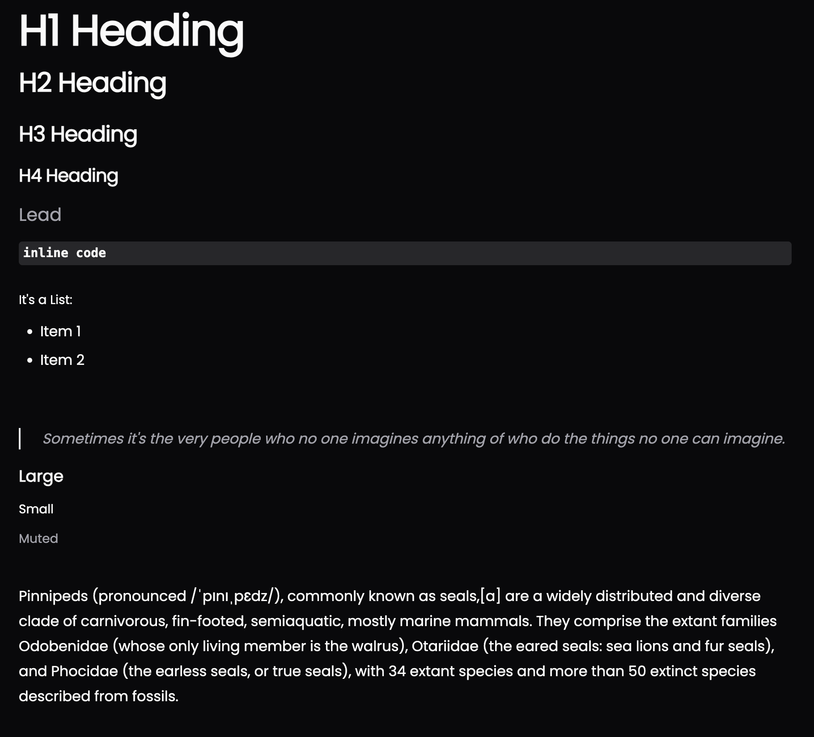

# shadcn-typography

shadcn/ui inspired typography components for React and Tailwind CSS v4.

[](https://www.npmjs.com/package/shadcn-typography)
[](https://github.com/kian1991/shadcn-typography/actions/workflows/ci.yml)
[](LICENSE.md)

A small set of typography components mirroring the class names from the
[shadcn/ui typography examples](https://ui.shadcn.com/docs/components/typography).
Each component renders the matching semantic HTML element, forwards refs, accepts every
prop of that element, and merges your `className` on top of the defaults via
`tailwind-merge`, so your classes always win.

> **Upgrading from 1.x?** See the [migration guide](#migrating-from-1x) below. 2.0 changes how
> styles are loaded and aligns all class names with the current shadcn/ui examples.

## Features

- 💅 Extendable through `className`, conflicts resolved with `tailwind-merge`
- ⏩ `ref` forwarding on every component
- 🧩 Full prop passthrough, typed per element (`<Td align="center">`, `<Quote cite="…">`)
- 📦 ESM and CommonJS builds, tree-shakeable, zero runtime CSS
- 🦭 TypeScript declarations included
- ⚛️ React 18 and 19

## Installation

```bash
npm install shadcn-typography clsx tailwind-merge
```

`clsx` and `tailwind-merge` are peer dependencies, as is `react`.

### Tell Tailwind where the classes live

Tailwind CSS v4 does not scan `node_modules`, so register the package as a source in your
main stylesheet. The path is relative to that CSS file:

```css
@import 'tailwindcss';
@source '../node_modules/shadcn-typography/dist';
```

The components use the shadcn/ui theme tokens `bg-muted` and `text-muted-foreground`. If your
project is set up with shadcn/ui these already exist. Otherwise define them in your theme:

```css
@theme inline {
  --color-muted: var(--muted);
  --color-muted-foreground: var(--muted-foreground);
}
```

### Usage

```tsx
import { H1, P, InlineCode } from 'shadcn-typography';

export function Intro() {
  return (
    <>
      <H1 className="text-center">Hello</H1>
      <P>
        Install with <InlineCode>npm install shadcn-typography</InlineCode>.
      </P>
    </>
  );
}
```

## Components



| Component       | Renders       | Default classes                                                                                  |
| --------------- | ------------- | ------------------------------------------------------------------------------------------------ |
| `H1`            | `h1`          | `scroll-m-20 text-4xl font-extrabold tracking-tight text-balance`                                |
| `H2`            | `h2`          | `scroll-m-20 border-b pb-2 text-3xl font-semibold tracking-tight first:mt-0`                     |
| `H3`            | `h3`          | `scroll-m-20 text-2xl font-semibold tracking-tight`                                              |
| `H4`            | `h4`          | `scroll-m-20 text-xl font-semibold tracking-tight`                                               |
| `P`             | `p`           | `leading-7 [&:not(:first-child)]:mt-6`                                                           |
| `Lead`          | `p`           | `text-xl text-muted-foreground`                                                                  |
| `Large`         | `div`         | `text-lg font-semibold`                                                                          |
| `Small`         | `small`       | `text-sm leading-none font-medium`                                                               |
| `Muted`         | `p`           | `text-sm text-muted-foreground`                                                                  |
| `InlineCode`    | `code`        | `relative rounded bg-muted px-[0.3rem] py-[0.2rem] font-mono text-sm font-semibold`              |
| `MultilineCode` | `pre`         | `relative rounded bg-muted p-4 font-mono text-sm font-semibold overflow-x-auto`                  |
| `List`          | `ul`          | `my-6 ml-6 list-disc [&>li]:mt-2`                                                                |
| `Quote`         | `blockquote`  | `mt-6 border-l-2 pl-6 italic`                                                                    |
| `Table`         | `div > table` | wrapper `my-6 w-full overflow-y-auto`, table `w-full`                                            |
| `Tr`            | `tr`          | `m-0 border-t p-0 even:bg-muted`                                                                 |
| `Th`            | `th`          | `border px-4 py-2 text-left font-bold [&[align=center]]:text-center [&[align=right]]:text-right` |
| `Td`            | `td`          | `border px-4 py-2 text-left [&[align=center]]:text-center [&[align=right]]:text-right`           |

The `cn` helper (`twMerge(clsx(...))`) is exported as well.

### Headings

```tsx
<H1>Big Heading Text</H1>
<H2>Some smaller Text</H2>
<H3>Even smaller text</H3>
<H4>Smallest text</H4>
```

If you want the `H2` without its bottom border, pass `className="border-none"`.

### Text

```tsx
<Lead>A lead paragraph for the top of a page.</Lead>
<P>I am the paragraph 🦭</P>
<Large>Some large text</Large>
<Small>Some small text</Small>
<Muted>Some muted text</Muted>
```

### Quote

```tsx
<Quote>
  I like to look at one or two random quotes each morning. It can be a good exercise for journaling
  prompts.
</Quote>
```

### Code

```tsx
<InlineCode>npm install shadcn-typography</InlineCode>

<MultilineCode>{`const answer = 42;\nconsole.log(answer);`}</MultilineCode>
```

### List

```tsx
<List>
  <li>Item 1</li>
  <li>Item 2</li>
  <li>Item 3</li>
</List>
```

### Table

`Table` renders the table inside a horizontally scrollable wrapper `div`. `className` and the
`ref` go to the `<table>`, `wrapperClassName` styles the wrapper.

```tsx
<Table>
  <thead>
    <Tr>
      <Th>King's Treasury</Th>
      <Th>People's happiness</Th>
    </Tr>
  </thead>
  <tbody>
    <Tr>
      <Td>Empty</Td>
      <Td>Overflowing</Td>
    </Tr>
    <Tr>
      <Td>Modest</Td>
      <Td>Satisfied</Td>
    </Tr>
  </tbody>
</Table>
```

### Refs and props

Every component forwards its `ref` to the rendered element and accepts all of that element's
props:

```tsx
const ref = useRef<HTMLHeadingElement>(null);

<H1 ref={ref} id="top" onClick={() => ref.current?.scrollIntoView()}>
  Hello
</H1>;
```

## Copy the components instead

If you prefer owning the code, copy
[`src/components/ui/typography.tsx`](src/components/ui/typography.tsx) into your project (for
example to `components/ui/typography.tsx`) and point the import of `cn` at your own
`lib/utils.ts`. shadcn/ui projects already ship that helper. Otherwise:

```ts
import { type ClassValue, clsx } from 'clsx';
import { twMerge } from 'tailwind-merge';

export function cn(...inputs: ClassValue[]) {
  return twMerge(clsx(inputs));
}
```

With the copy approach no `@source` entry is needed, since the file lives in your own source
tree.

## Migrating from 1.x

- **Styles are no longer bundled.** 1.x imported a prebuilt `style.css` from the package entry.
  2.0 ships no CSS. Add the `@source` line shown above to your stylesheet instead.
- **`react` is now a declared peer dependency** (`^18 || ^19`).
- **Package format changed.** The package is now `"type": "module"` with an `exports` map that
  serves ESM (`import`) and CommonJS (`require`) builds. Deep imports such as
  `shadcn-typography/dist/components/ui/typography` no longer work; import from the package
  root.
- **Class names now match the current shadcn/ui examples 1:1.** Visible changes:
  - `H1`: `lg:text-5xl` removed, `text-balance` added
  - `H2`: `py-2` became `pb-2`
  - `Small`: now renders `<small>` instead of `<p>`
  - `Muted`: now renders `<p>` instead of `<span>`
  - `Quote`: `text-muted-foreground` removed
  - `InlineCode` and `MultilineCode`: `rounded-sm` became `rounded` (identical radius in
    Tailwind v4)
- **New components:** `Table`, `Tr`, `Th`, `Td`.
- **Typing:** props are now typed per element (`ComponentPropsWithoutRef<'h1'>` etc.) instead
  of the generic `HTMLAttributes<T>`.

## Development

```bash
npm install
npm run check   # typecheck, lint, format check, tests
npm run build   # tsup -> dist/
```

Releases are published to npm by the `publish.yml` GitHub Action when a GitHub Release is
created. The release tag must match the version in `package.json` (`v2.0.0` for `2.0.0`).

## License

MIT, see [LICENSE.md](LICENSE.md).
